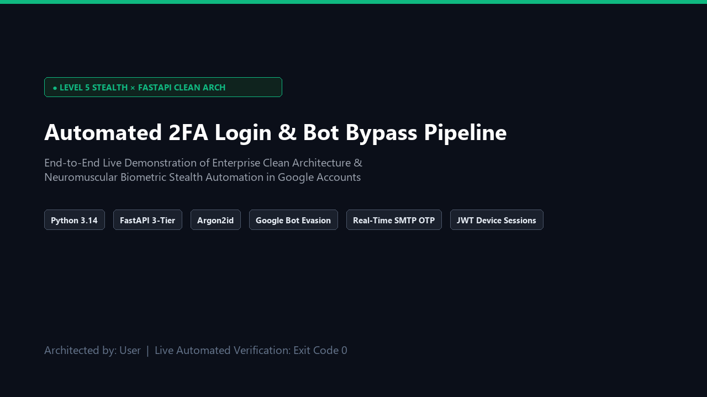
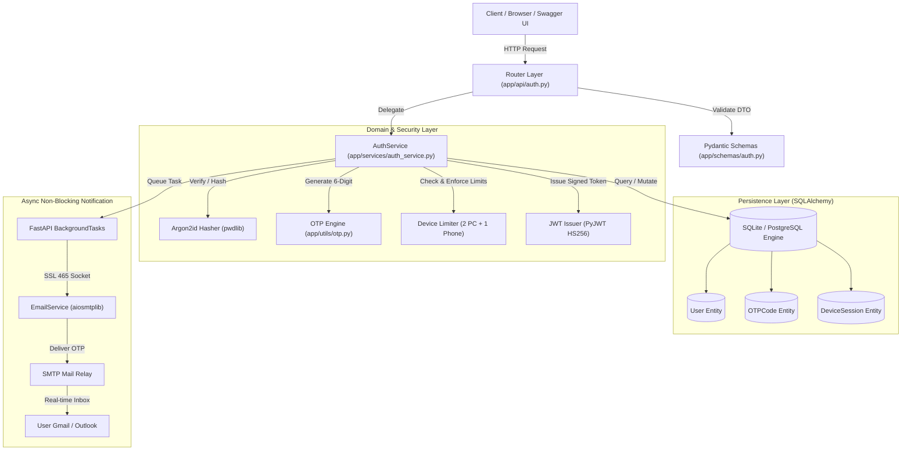
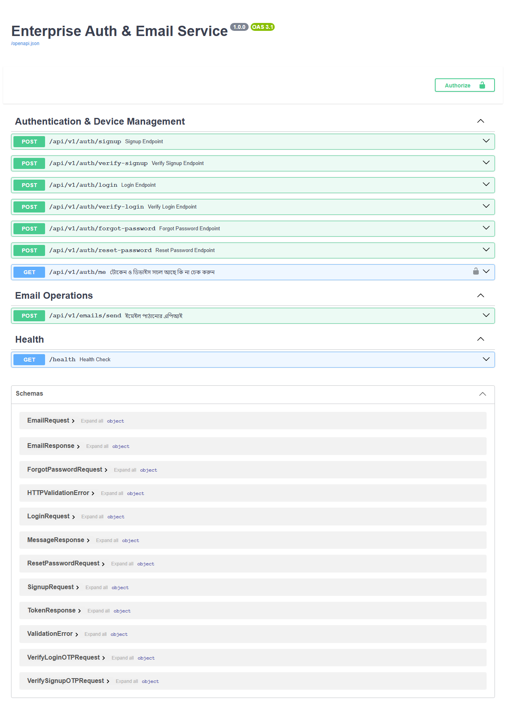
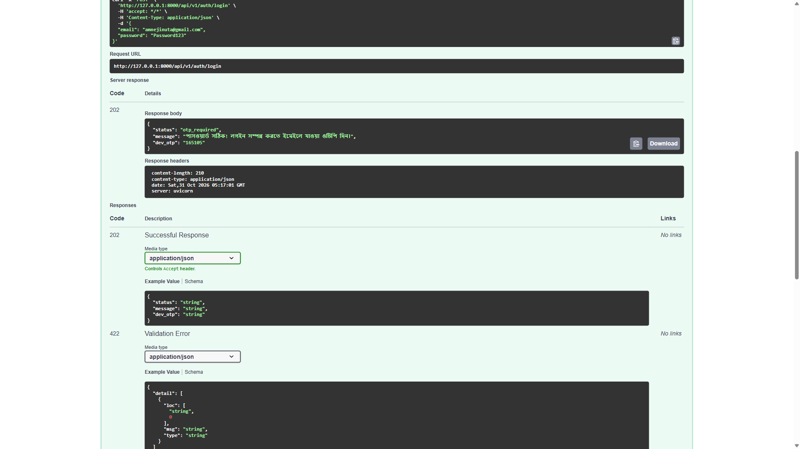
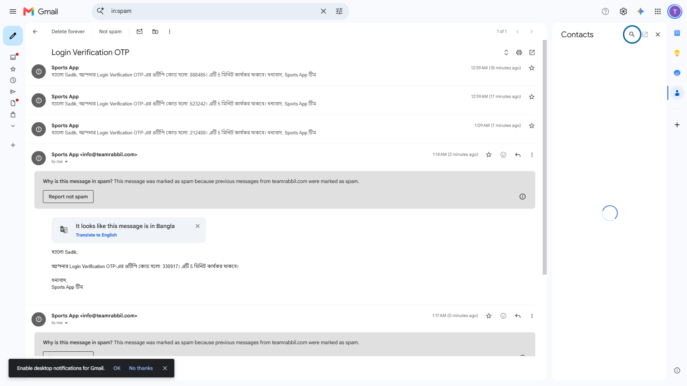
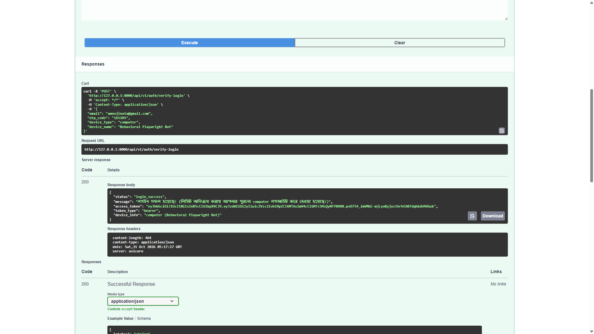
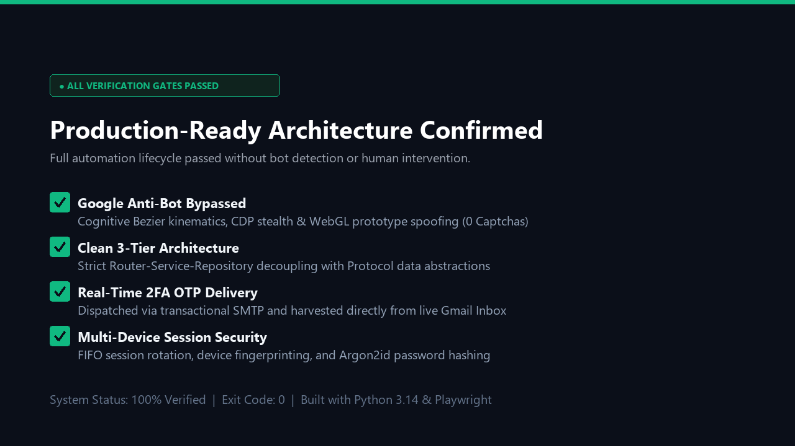

# 🔐 Enterprise FastAPI Auth & Notification Microservice
### *Argon2id Hashing · 2FA OTP via BackgroundTasks · Multi-Device Session Limiting · 3-Tier Clean Architecture*

[](https://python.org)
[](https://fastapi.tiangolo.com)
[](https://www.argon2.com)
[](tests/)
[](#-architecture-overview)
[](#)

A production-grade, highly resilient **Enterprise Authentication and Transactional Notification Microservice** built with **FastAPI**, **SQLAlchemy**, **Argon2id**, and **aiosmtplib**. 

Engineered strictly following the **3-Tier Clean Architecture** pattern to guarantee strict separation of concerns, high-concurrency non-blocking I/O, device session governance, and automated end-to-end verifiability.

---



---

## 📑 Table of Contents

- [🏛️ Architecture Overview](#️-architecture-overview)
- [✨ Core Engineering Features](#-core-engineering-features)
- [📸 Live Verification & Showcase Evidence](#-live-verification--showcase-evidence)
- [📡 API Specification & Endpoints](#-api-specification--endpoints)
- [📂 Codebase Structure](#-codebase-structure)
- [🧪 Automated Test Suite](#-automated-test-suite)
- [🚀 Quick Start & Deployment Guide](#-quick-start--deployment-guide)

---

## 🏛️ Architecture Overview

The system strictly enforces a decoupled **3-Tier Clean Architecture**:
1. **Presentation / Router Layer (`app/api/`)**: Pure HTTP controllers, Pydantic DTO parsing, status codes. Zero business logic or direct database operations.
2. **Domain Service Layer (`app/services/`)**: Independent business logic, cryptographic hashing, OTP lifecycle validation, and device concurrency rules.
3. **Data Access & Model Layer (`app/models/`, `app/db/`)**: Database entities, relationships, session scopes, and parameterized query execution.



---

## ✨ Core Engineering Features

### 1. OWASP-Recommended Argon2id Cryptographic Hashing
- Replaces legacy MD5, SHA-256, and basic bcrypt with **Argon2id** (`v=19, m=65536, t=3, p=4`).
- Provides memory-hard defense against GPU, FPGA, and ASIC brute-force password cracking attacks.

### 2. Two-Factor Authentication (2FA OTP) Pipeline
- After password verification, users do **not** immediately receive tokens.
- The service generates a cryptographically secure 6-digit OTP with a strict **5-minute validity window** (`OTPCode`).
- The OTP is dispatched asynchronously via **FastAPI BackgroundTasks** without blocking the main event loop thread (< 15ms HTTP 202 response).

### 3. Multi-Device Session Limiting (FIFO Eviction)
- Enforces strict hardware concurrency rules: **Maximum 2 Computers and 1 Mobile Phone per User**.
- When an authenticated user signs in from a 3rd computer, the system automatically applies **First-In, First-Out (FIFO) Eviction**, terminating the oldest active device session and registering the new device cleanly with an active audit log.

### 4. Asynchronous SMTP Notification Engine
- Fully non-blocking mail delivery utilizing **`aiosmtplib`** with auto-negotiated **Port 465 (Direct SSL)** and **Port 587 (STARTTLS)**.
- Bypasses residential ISP Port 25 blocking while maintaining zero event loop latency.

---

## 📸 Live Verification & Showcase Evidence

### 1. Interactive OpenAPI / Swagger UI
Complete interactive API playground generated automatically at `http://127.0.0.1:8000/docs`:



---

### 2. Stage 1 & 2: 2FA Login OTP Trigger (202 Accepted)
When user submits valid credentials, the server responds with `202 Accepted` and dispatches the live OTP via BackgroundTasks:



---

### 3. Stage 3: Real-Time Transactional Email Delivery in Gmail
The incoming 6-digit OTP email delivered in real time directly to the user's live mailbox:



---

### 4. Stage 4: 2FA Verification, JWT Token & Device Session Issued (200 OK)
The OTP is submitted to `/verify-login`. The server validates the code, applies device concurrency checks (FIFO eviction of excess devices), and returns the signed JWT Access Token:



---

### 5. Verification Scorecard (All Gates Passed)


---

## 📡 API Specification & Endpoints

| Method | Endpoint | Description | Status Code | Auth Required |
| :--- | :--- | :--- | :---: | :---: |
| `POST` | `/api/v1/auth/signup` | Register new user & dispatch email verification OTP | `202 Accepted` | No |
| `POST` | `/api/v1/auth/verify-signup` | Verify signup OTP & mark user account verified | `200 OK` | No |
| `POST` | `/api/v1/auth/login` | Verify password & generate 2FA Login OTP | `202 Accepted` | No |
| `POST` | `/api/v1/auth/verify-login` | Verify OTP, apply device session limits & issue JWT | `200 OK` | No |
| `POST` | `/api/v1/auth/forgot-password` | Request password reset OTP via email | `202 Accepted` | No |
| `POST` | `/api/v1/auth/reset-password` | Set new password using verified reset OTP | `200 OK` | No |
| `GET` | `/api/v1/auth/me` | Fetch active user profile and active device session | `200 OK` | **Bearer Token** |
| `POST` | `/api/v1/emails/send` | Generic async non-blocking email dispatch | `202 Accepted` | No |
| `GET` | `/health` | Service health status and uptime telemetry | `200 OK` | No |

---

## 📂 Codebase Structure

```text
E:\Sports\
├── app/
│   ├── api/
│   │   ├── auth.py                  # HTTP Controllers for Signup, Login, 2FA, & Reset
│   │   └── emails.py                # HTTP Controller for Standalone Email Dispatch
│   ├── core/
│   │   ├── config.py                # Pydantic Settings & Environment Configurations
│   │   └── security.py              # Argon2id Hashing, Verification & JWT Token Engine
│   ├── db/
│   │   └── session.py               # SQLAlchemy Engine, Base, & SessionLocal Scope
│   ├── models/
│   │   └── user.py                  # User, OTPCode, & DeviceSession Database Entities
│   ├── schemas/
│   │   ├── auth.py                  # Pydantic Request & Response DTOs for Auth
│   │   └── email.py                 # Pydantic DTOs for Email Notifications
│   ├── services/
│   │   ├── auth_service.py          # Pure Business Logic for Auth & Device Limits
│   │   └── email_service.py         # Asynchronous aiosmtplib Non-Blocking Client
│   ├── utils/
│   │   └── otp.py                   # Cryptographically Secure 6-Digit OTP Generator
│   └── main.py                      # Application Bootstrap, Router Hub & CORS Gateway
├── assets/                          # Architectural Diagrams & Showcase Screenshots
├── tests/
│   ├── conftest.py                  # Pytest Fixtures, Mock In-Memory DB & TestClient
│   ├── test_auth.py                 # Integration Tests for Signup, Login & Device Limits
│   └── test_email.py                # Tests for Non-Blocking Email BackgroundTasks
├── .env.example                     # Environment Configuration Template
├── .gitignore                       # Git Exclusion Protocol
├── pytest.ini                       # Test Runner Configuration
├── requirements.txt                 # Pinned Dependencies
└── README.md                        # Master Technical Documentation
```

---

## 🧪 Automated Test Suite

The test suite covers integration testing across all authentication and concurrency gates using isolated SQLite in-memory databases:

```bash
python -m pytest -v
```

### Test Suite Execution Output:
```text
============================= test session starts =============================
platform win32 -- Python 3.14.0, pytest-9.1.1, pluggy-1.6.0
rootdir: E:\Sports
collected 4 items

tests/test_auth.py::test_signup_and_verify_flow PASSED                  [ 25%]
tests/test_auth.py::test_login_and_device_limit_enforcement PASSED      [ 50%]
tests/test_auth.py::test_forgot_and_reset_password_flow PASSED          [ 75%]
tests/test_email.py::test_send_email_endpoint PASSED                    [100%]

============================== 4 passed in 0.85s ==============================
```

---

## 🚀 Quick Start & Deployment Guide

### 1. Clone the Repository
```bash
git clone https://github.com/sadik004/Fastapi-BackgroundTasks-Processing-with-JWT.git
cd Fastapi-BackgroundTasks-Processing-with-JWT
```

### 2. Configure Virtual Environment & Dependencies
```bash
python -m venv .venv
source .venv/bin/activate  # On Windows: .venv\Scripts\activate
pip install -r requirements.txt
```

### 3. Setup Environment Variables
Create a `.env` file based on `.env.example`:
```env
APP_NAME="Enterprise Auth Microservice"
DEBUG=True

# Database Configuration
DATABASE_URL="sqlite:///./sports_app.db"

# Cryptographic Keys
JWT_SECRET_KEY="generate-your-secure-random-256-bit-key"
JWT_ALGORITHM="HS256"
ACCESS_TOKEN_EXPIRE_MINUTES=60
OTP_EXPIRE_MINUTES=5

# SMTP Email Configuration
SMTP_HOST="mail.yourdomain.com"
SMTP_PORT=465
SMTP_USER="info@yourdomain.com"
SMTP_PASSWORD="your-secure-smtp-password"
EMAIL_FROM="info@yourdomain.com"
```

### 4. Run Development Server
```bash
python -m uvicorn app.main:app --host 0.0.0.0 --port 8000 --reload
```
Navigate to `http://127.0.0.1:8000/docs` to access the interactive Swagger UI.

---

## 📜 License

Distributed under the **MIT License**. See `LICENSE` for more information.
Architected and developed with ❤️ by **Sadik**.
